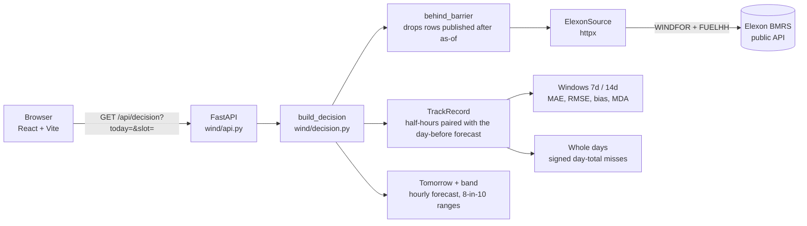

# GB day-ahead wind forecast and its track record

**Live: https://wind-day-ahead.vercel.app**

The GB day-ahead power auction (N2EX) closes at **09:50 UK time**. The last wind forecast before it is published at **09:30**. This screen is for those 20 minutes: it shows tomorrow's wind forecast exactly as it looked that morning, and how far off that same forecast has been lately.

It simulates **January 2026** using public Elexon BMRS data. Pick any January day as "today", and the screen shows only what was known at 09:30 that day. It shows data and never advises.

## What it shows

- **Tomorrow:** the whole day's forecast (total MWh, lowest and highest hour) as hourly steps, with a shaded band showing where it would land if it missed the way the last 14 days did.
- **The whole day:** the average miss of the last 14 whole days (MWh and %), and the middle 8 in 10 of those daily misses applied to tomorrow's total. All 14 days are listed underneath.
- **Hour by hour:** the typical half-hour miss and its lean over the last 7 days.
- **Scorecard:** MAE, RMSE, bias and MDA for the last 7 and 14 days, each with a plain-English meaning.
- **History:** forecast against actual for every scored half-hour.

Every chart has a Table view.

## How the numbers are worked out

| Rule | What it means |
|---|---|
| **As of 09:30** (or 02:30, 04:30, 07:30) | Anything published after that moment is never used, forecasts or actuals. The historical API happily returns "future" rows, so the engine refuses them at the door. |
| **Same product** | Each past half-hour is scored against the forecast published at the same time **the day before**: the forecast you'd actually have had at the gate. |
| **Held flat** | Forecasts are hourly and actuals half-hourly. The 10:00 forecast covers both 10:00 and 10:30; no forecast values are invented. |
| **Miss = forecast − actual** | Positive means the forecast was too high. Every signed number carries words ("forecast higher"). |
| **MDA** | Did the forecast call the hour-to-hour ups and downs right? Judged within each day, on complete hours only. |
| **Band and day range** | The 10th to 90th percentile of past misses ("8 in 10"), applied to tomorrow. Both were back-tested over every January day: the hourly band caught 79.9% and the day range 80.6%. |

## Architecture



- **One front door.** Everything goes through `build_decision(today, slot, source, settings)`. Fetching, the barrier, pairing and scoring all sit behind it, and it returns one JSON answer.
- **The barrier is a bouncer, not a filter.** Its first step wraps the data source, so unfiltered rows never enter the engine. A "poisoned row" test feeds in data published at 09:31 and checks the output doesn't change by a single byte.
- **The frontend only renders.** All the maths is in Python. The TypeScript types are generated from the API's own OpenAPI schema, and `make check` fails if they drift.
- **No database.** January 2026 is history, so each answer is cached at the CDN for a year. Errors are never cached.
- **Every operational value is a setting** (windows, percentiles, slots, cache ages, Elexon URL), overridable with `WIND_*` environment variables.

## File structure

```
.
├── apps/
│   ├── api/                      Python 3.14 · FastAPI · uv
│   │   ├── main.py               the app (Vercel + uvicorn entrypoint)
│   │   ├── wind/
│   │   │   ├── api.py            HTTP: /api/decision, /api/health, plain-sentence errors, cache headers
│   │   │   ├── decision.py       build_decision: the one front door
│   │   │   ├── barrier.py        behind_barrier: refuses anything published after as-of
│   │   │   ├── track_record.py   past half-hours + their forecast; windows and whole days
│   │   │   ├── scoring.py        MAE, RMSE, bias, percentile, direction agreement
│   │   │   ├── elexon.py         the Elexon client; every failure raises ElexonError
│   │   │   ├── source.py         the Source interface (real Elexon or a test fake)
│   │   │   ├── models.py         rows in, DecisionView out (also the API schema)
│   │   │   ├── settings.py       every operational value, overridable via WIND_*
│   │   │   └── cli.py            print any day's answer as JSON
│   │   ├── tests/                engine, Elexon client, API, golden + one live Elexon test
│   │   └── Dockerfile            production image (non-root, locked venv)
│   └── web/                      React 19 · TypeScript · Vite · Recharts
│       ├── src/
│       │   ├── App.tsx           the one screen; the chosen day and slot live in the URL
│       │   ├── components/       Controls, Tomorrow, DayRange, HourlyMiss, ForecastChart,
│       │   │                     Accuracy, WholeDaysTable, History, HistoryChart, ViewSwitch
│       │   ├── api.ts            fetch + error messages      api/  generated API types
│       │   ├── format.ts         MW, MWh, signs and UK time: every number goes through here
│       │   ├── useDecision.ts    loading / error / ready     simulation.ts  days, slots, gate
│       │   ├── tokens.css        colours, type and spacing (light + dark)
│       │   └── test/             a real recorded API answer + a network fake
│       ├── e2e/smoke.spec.ts     Playwright: a real browser against a running deployment
│       ├── nginx.conf            production web server: SPA + /api proxy
│       └── Dockerfile            production image (nginx, non-root)
├── compose.yaml                  dev profile (hot reload) and prod profile (production images)
├── Makefile                      install, dev, check, smoke, api-types
├── vercel.json                   Vercel Services: web + api in one project
└── CLAUDE.md                     working notes: conventions, glossary, commands
```

## Run it

You need **Docker**. To run without Docker, you need **uv** and **Node 24+** instead.

```sh
make dev       # web on http://localhost:5173, API docs on http://localhost:8000/api/docs
```

Without Docker:

```sh
cd apps/api && uv sync && uv run fastapi dev     # API on :8000
cd apps/web && npm ci && npm run dev             # web on :5173, proxies /api to :8000
```

Everything else:

```sh
make check     # lint, types, unit + page tests (incl. one live Elexon call), type drift, build
make smoke     # build the production images, run a real browser against them on :8080, tear down
cd apps/api && uv run python -m wind.cli 2026-01-15 09:30   # any day's answer as JSON
```

The API, if you want it directly:

```
GET /api/decision?today=2026-01-15&slot=09:30   tomorrow, band, scorecard, whole days, history
GET /api/health                                 200 when Elexon is reachable, 503 when it isn't
```

## Deploy

Deploys are **manual**. The GitHub repo isn't connected to Vercel, so merging never ships anything by itself.

```sh
npx vercel@65.2.0 deploy          # preview (behind Vercel login)
# check it, then:
npx vercel@65.2.0 deploy --prod
make smoke-url SMOKE_URL=https://wind-day-ahead.vercel.app
```

## Tests

- **API (68):**
  - the engine, through `build_decision`, with hand-worked numbers;
  - the Elexon client against a fake network, including 12 ways Elexon can fail;
  - the HTTP API;
  - a **golden test** that runs recorded real January data and must match an independently written answer key exactly;
  - one live Elexon call.
- **Web (44):**
  - the whole page as a person uses it, with only the network faked (a real recorded API answer);
  - the formatting rules, including UK time on a non-UK machine.
- **Smoke (2):** a real browser against the production build, or against the live site.

## Data

[Elexon BMRS](https://bmrs.elexon.co.uk/) public API, no key needed:
- **WINDFOR:** hourly wind forecasts, published 8 times a day.
- **FUELHH:** half-hourly metered generation by fuel type.

## Credits

Designed and directed by **dizziedbliss**. Built in pair with **Claude** (Anthropic's Claude Opus 5.5) in Claude Code, test-first, one reviewed PR per stage.
